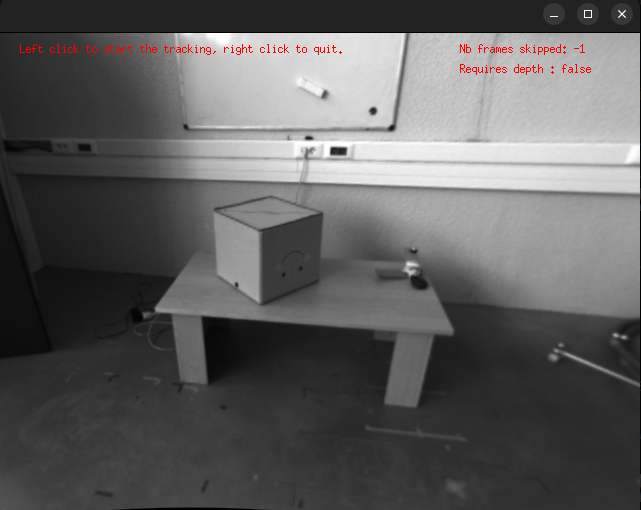
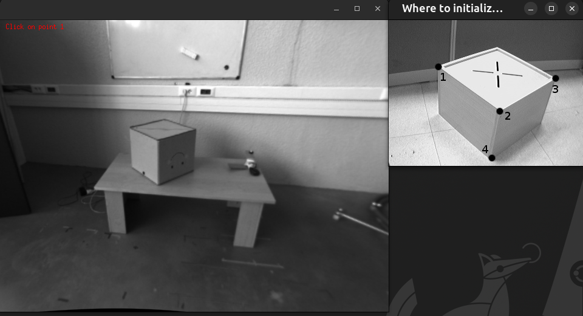
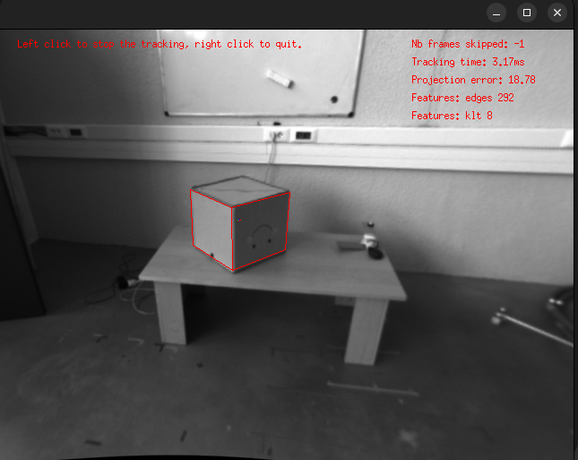

Model-Based Tracker (MBT) tutorial
==================================

This is a tutorial for the ``visp_mbt`` package. The documentation of the Model-Based Tracker (MBT) provided
by ViSP can be found `here <https://visp-doc.inria.fr/doxygen/visp-daily/classvpMbGenericTracker.html>`__
ViSP documentation also provides step-by-step tutorials to progressively learn how to use the MBT
`here <https://visp-doc.inria.fr/doxygen/visp-daily/tutorial-tracking-mb-generic.html>`__ .

Consequently, this tutorial will not focus on explaining the meaning of the different parameters of the
MBT, but instead focus on the specificities on how to use the ``visp_mbt`` package.

A node of the ``visp_mbt`` package can either be initialized using a `JSON` configuration file or an `XML` configuration
file. Depending on the type of the configuration file, some parameters of the node must be or must not be set.
Consequently, we will study the two cases separately.

Tutorial using a JSON file
--------------------------

Purpose of this tutorial
++++++++++++++++++++++++

The purpose of this tutorial is to show how to configure a ``visp_mbt`` node using a JSON file.
We begin with this kind of file because it is the simplest way of configuring the node.
If you have the choice between the XML and the JSON options, we suggest you to use a ``JSON`` file.
See `ViSP tutorial <https://visp-doc.inria.fr/doxygen/visp-daily/tutorial-mb-generic-json.html>`__ for
more information.

How to launch it
++++++++++++++++
If you compiled the packages, you have to source the workspace in which you have compiled the packages.
Otherwise, if you installed the packages using the package manager, you only have to source the ``/opt/ros/${ROS_DISTRO}/setup.bash``
file (or one of the other ``setup`` files if you are not using bash).

Then you can run:

.. code-block:: shell

  ros2 launch visp_tk_tutorials mbt_box_bag_json_launch.py

The launch file accepts different arguments. To have the list and the explanations related to the
arguments, please run:

.. code-block:: shell

  ros2 launch visp_tk_tutorials mbt_box_bag_json_launch.py --show-args

When you first start the launch file, you should see something similar to the following image:

After left clicking on the image, the tracker will be turned on, and you should see

After having click on the corners of the cube, respecting the ordering explained in the small
window that opened on the side, you should see the cube being tracked. A left click will momentarily pause
the tracker, while a right click will kill the node.

Using another configuration file
++++++++++++++++++++++++++++++++

The settings of the tracker (visual features, moving edges and KLT parameters, camera, clipping...) are given by
the configuration file passed with the ``config_file`` launch argument. It must be an absolute path. To use a file
installed with the package, you can build this path with ``ros2 pkg prefix``. For instance, to run the same
tutorial with a copy of ``box.json`` that you modified:

.. code-block:: shell

  cp $(ros2 pkg prefix visp_tk_tutorials)/share/visp_tk_tutorials/config/mbt/box/box.json /tmp/my_box.json
  # Edit /tmp/my_box.json, then:
  ros2 launch visp_tk_tutorials mbt_box_bag_json_launch.py config_file:=/tmp/my_box.json

The configuration files provided with the package are described in a ``README.md`` file next to them:

- ``config/mbt/box/``: ``box.json`` and ``box.xml``, to track the box of this tutorial with the color camera;
- ``config/mbt/teabox/``: ``teabox.json``, to track a teabox with a RealSense color and depth camera
  (see `Tutorial using a Realsense camera`_). It requires a depth stream, which the recorded sequence of this
  tutorial does not provide.

When the tracked object changes, the 3D model and the initialization points must change too: in a JSON file, the
model is given by the ``model`` key, and the file giving the points to click at initialization by the ``init_file``
launch argument.

If a file does not exist, the tracker cannot be initialized: the node displays an error, stops, and the launch
file ends.

Code explanation
++++++++++++++++

Let's have a look at ``mbt_box_bag_json_launch.py``. Because it is a fairly big file, we will study the parts
separately. Let's first have a look to the :py:func:`generate_launch_description` method that is called
by the ``ros2 launch`` utilitary or by a call to ``IncludeLaunchDescription`` in another launch file:

.. literalinclude:: /_code/launch/mbt_box_bag_json_launch.py
  :language: python
  :lineno-match:
  :start-at: def generate_launch_description():
  :end-at: return ld

As you can see, the :py:func:`generate_launch_description` method mostly declare the launch arguments and
register an :py:class:`OpaqueFunction` object that will be called once the context of the launch file will
be known. However, it is important to notice that it also sets an OpenMP environment variable. It helps accelerate
the processing of depth images when the depth stream is used too.

Here is a quick overview of the :py:func:`prepare_parameters` function:

.. literalinclude:: /_code/launch/mbt_box_bag_json_launch.py
  :language: python
  :lineno-match:
  :start-at: def prepare_parameters(context):
  :end-before: def generate_launch_description():

First, we get the launch arguments values and store them in a dictionnary that will serve
at initializing the node:

.. literalinclude:: /_code/launch/mbt_box_bag_json_launch.py
  :language: python
  :lineno-match:
  :start-at: ## [Getting the launch arguments values]
  :end-before: ## [Checking the validity of some launch arguments]

Then, we check the validity of some launch arguments. The parsing of empty lists in ROS2 can
be problematic, so we have to use a small trick to handle that case:

.. literalinclude:: /_code/launch/mbt_box_bag_json_launch.py
  :language: python
  :lineno-match:
  :start-at: ## [Checking the validity of some launch arguments]
  :end-before: ## [Instanciating the node]

Then, we instanciate the ``visp_mbt`` node, using the dictionnary that we previously filled:

.. literalinclude:: /_code/launch/mbt_box_bag_json_launch.py
  :language: python
  :lineno-match:
  :start-at: ## [Instanciating the node]
  :end-before: ## [Rosbag player]

Then, we create a process that will play the rosbag:

.. literalinclude:: /_code/launch/mbt_box_bag_json_launch.py
  :language: python
  :lineno-match:
  :start-at: ## [Rosbag player]
  :end-before: ## [Launching nodes]

Then, we group the spawning of the node and of the process into a :py:class:`GroupAction` object:

.. literalinclude:: /_code/launch/mbt_box_bag_json_launch.py
  :language: python
  :lineno-match:
  :start-at: ## [Launching nodes]
  :end-before: ## [Handling shutdown]

Finally, we ask to shutdown the whole launch file when the ``visp_mbt`` node dies:

.. literalinclude:: /_code/launch/mbt_box_bag_json_launch.py
  :language: python
  :lineno-match:
  :start-at: ## [Handling shutdown]
  :end-before: def generate_launch_description():

Tutorial using an XML file
--------------------------

Purpose of this tutorial
++++++++++++++++++++++++

The purpose of this tutorial is to show how to configure a ``visp_mbt`` node using an XML file.
If you have the choice between the two options, we suggest you to use a ``JSON`` file instead,
but you may not have the possibility if ViSP has not been compiled with the required dependency.
See `ViSP tutorial <https://visp-doc.inria.fr/doxygen/visp-daily/tutorial-mb-generic-json.html>`__ for
more information.

How to launch it
++++++++++++++++
If you compiled the packages, you have to source the workspace in which you have compiled the packages.
Otherwise, if you installed the packages using the package manager, you only have to source the ``/opt/ros/${ROS_DISTRO}/setup.bash``
file (or one of the other ``setup`` files if you are not using bash).

Then you can run:

.. code-block:: shell

  ros2 launch visp_tk_tutorials mbt_box_bag_xml_launch.py

The launch file accepts different arguments. To have the list and the explanations related to the
arguments, please run:

.. code-block:: shell

  ros2 launch visp_tk_tutorials mbt_box_bag_xml_launch.py --show-args

When you first start the launch file, you should see something similar to the following image:

After left clicking on the image, the detector will be turned on, and you should see

After having click on the corners of the cube, respecting the ordering explained in the small
window that opened on the side, you should see the cube being tracked. A left click will momentarily pause
the tracker, while a right click will kill the node.

Code explanation
++++++++++++++++

Let's have a look at ``mbt_box_bag_xml_launch.py``. Because it is a fairly big file, we will study the parts
separately. Let's first have a look to the :py:func:`generate_launch_description` method that is called
by the ``ros2 launch`` utilitary or by a call to ``IncludeLaunchDescription`` in another launch file:

.. literalinclude:: /_code/launch/mbt_box_bag_xml_launch.py
  :language: python
  :lineno-match:
  :start-at: def generate_launch_description():
  :end-at: return ld

As you can see, the :py:func:`generate_launch_description` method mostly declare the launch arguments and
register an :py:class:`OpaqueFunction` object that will be called once the context of the launch file will
be known. However, it is important to notice that it also sets an OpenMP environment variable. It helps accelerate
the processing of depth images when the depth stream is used too. It is also interesting to notice that in the case
of using an XML configuration file, the parameters ``rgb_model_file``, ``tracker_names`` and ``tracker_types`` must be set.

Here is a quick overview of the :py:func:`prepare_parameters` function:

.. literalinclude:: /_code/launch/mbt_box_bag_xml_launch.py
  :language: python
  :lineno-match:
  :start-at: def prepare_parameters(context):
  :end-before: def generate_launch_description():

First, we get the launch arguments values and store them in a dictionnary that will serve
at initializing the node:

.. literalinclude:: /_code/launch/mbt_box_bag_xml_launch.py
  :language: python
  :lineno-match:
  :start-at: ## [Getting the launch arguments values]
  :end-before: ## [Checking the validity of some launch arguments]

Then, we check the validity of some launch arguments. The parsing of empty lists in ROS2 can
be problematic, so we have to use a small trick to handle that case:

.. literalinclude:: /_code/launch/mbt_box_bag_xml_launch.py
  :language: python
  :lineno-match:
  :start-at: ## [Checking the validity of some launch arguments]
  :end-before: ## [Instanciating the node]

Then, we instanciate the ``visp_mbt`` node, using the dictionnary that we previously filled:

.. literalinclude:: /_code/launch/mbt_box_bag_xml_launch.py
  :language: python
  :lineno-match:
  :start-at: ## [Instanciating the node]
  :end-before: ## [Rosbag player]

Then, we create a process that will play the rosbag:

.. literalinclude:: /_code/launch/mbt_box_bag_xml_launch.py
  :language: python
  :lineno-match:
  :start-at: ## [Rosbag player]
  :end-before: ## [Launching nodes]

Then, we group the spawning of the node and of the process into a :py:class:`GroupAction` object:

.. literalinclude:: /_code/launch/mbt_box_bag_xml_launch.py
  :language: python
  :lineno-match:
  :start-at: ## [Launching nodes]
  :end-before: ## [Handling shutdown]

Finally, we ask to shutdown the whole launch file when the ``visp_mbt`` node dies:

.. literalinclude:: /_code/launch/mbt_box_bag_xml_launch.py
  :language: python
  :lineno-match:
  :start-at: ## [Handling shutdown]
  :end-before: def generate_launch_description():

Tutorial using a Realsense camera
---------------------------------

Purpose of this tutorial
++++++++++++++++++++++++

The purpose of this tutorial is to show how to configure a ``visp_mbt`` node when using an RGBD sensor.
We chose to use a Realsense RGBD sensor, and deliberately chose not to require the depth stream aligned
with the color stream in order to show you how to face such a situation.

How to launch it
++++++++++++++++
If you compiled the packages, you have to source the workspace in which you have compiled the packages.
Otherwise, if you installed the packages using the package manager, you only have to source the ``/opt/ros/${ROS_DISTRO}/setup.bash``
file (or one of the other ``setup`` files if you are not using bash).

Then you can run:

.. code-block:: shell

  ros2 launch visp_tk_tutorials mbt_teabox_live_rs2_json_launch.py

The launch file accepts different arguments. To have the list and the explanations related to the
arguments, please run:

.. code-block:: shell

  ros2 launch visp_tk_tutorials mbt_teabox_live_rs2_json_launch.py --show-args

If nothing appears on screen, it may mean that the ``realsense_camera`` package changed the names of
the topic on which are published the data. Please run ``ros2 topic list`` and ``ros2 topic info -v /<camera_topic>``
to check if the ``realsense_camera`` publisher and the ``mbt_node`` subscriber are both listed.
If not, please change the topic names accordingly.

Using another configuration file with the camera
++++++++++++++++++++++++++++++++++++++++++++++++

As with the recorded sequence, the configuration file is given by the ``config_file`` launch argument. By default,
it is ``teabox.json``, which combines a ``Color`` tracker (moving edges and KLT keypoints) and a ``Depth`` tracker
(``depthNormal``). Its parameters are described in ``config/mbt/teabox/README.md``. To use a modified copy:

.. code-block:: shell

  cp $(ros2 pkg prefix visp_tk_tutorials)/share/visp_tk_tutorials/config/mbt/teabox/teabox.json /tmp/my_teabox.json
  # Edit /tmp/my_teabox.json, then:
  ros2 launch visp_tk_tutorials mbt_teabox_live_rs2_json_launch.py config_file:=/tmp/my_teabox.json

The names of the trackers in the JSON file (``Color`` and ``Depth``) must match the first element of the
``reference_tracker`` and ``other_tracker`` launch arguments, used to get the extrinsics between the two cameras.

Before starting the camera and the tracker, this launch file checks that the files given by ``config_file``,
``init_file``, ``rgb_model_file`` and ``depth_model_file`` exist (the empty ones are ignored). If one of them does
not, the launch file ends immediately with an explicit error, for example:

.. code-block:: shell

  [ERROR] [launch]: Caught exception in launch (see debug for traceback): Launch argument 'config_file': file '/path/to/file.json' does not exist

Code explanation
++++++++++++++++

We will only show the explanation of how is handled the fact that we use a depth stream that is not aligned
with the color stream.

.. literalinclude:: /_code/launch/mbt_teabox_live_rs2_json_launch.py
  :language: python
  :lineno-match:
  :start-at: ## [Realsense camera component]
  :end-before: ## [Handling shutdown]

The camera driver (``realsense2_camera::RealSenseNodeFactory``) and the tracker (``visp_mbt::MBTTracker``) are loaded
as components in the same container, with intra-process communication enabled, so that the color and depth images are
passed to the tracker without going through DDS. The container must be single-threaded: the ViSP displays used by the
tracker must always be used from the thread that created them.

In the parameters of the camera component, we explicitly ask not to align the depth stream with the color stream, and to
publish the TFs in order to have the transform between the frames of the two sensors (the color one and the depth one).

.. literalinclude:: /_code/launch/mbt_teabox_live_rs2_json_launch.py
  :language: python
  :lineno-match:
  :start-at: ## [Launch argument for aligning streams, color stream]
  :end-before: ## [End launch argument for aligning streams, color stream]

By telling that the ``reference_tracker`` is the ``Color`` one, we mean that the tracking results will be expressed with
regard to the color sensor. We then give the name of the frame that corresponds to the color sensor.

.. literalinclude:: /_code/launch/mbt_teabox_live_rs2_json_launch.py
  :language: python
  :lineno-match:
  :start-at: ## [Launch argument for aligning streams, depth stream]
  :end-before: ## [End launch argument for aligning streams, depth stream]

By telling that the ``other_tracker`` is the ``Depth`` one, we mean that the tracking features of the depth frame will be
translated into the frame of the color sensor. We then give the name of the frame that corresponds to the depth sensor
to extract the extrinsics from the TFs that are published.

Display of the object frame
---------------------------

When the tracking succeeds, the frame of the object is displayed on the image, with its X, Y and Z axes in red,
green and blue. Its size and thickness can be changed with two launch arguments, accepted by all the launch files of
this package:

.. list-table::
   :header-rows: 1
   :widths: 25 15 60

   * - Launch argument
     - Default
     - Meaning
   * - ``frame_size_ratio``
     - ``0.3``
     - | Length of the axes, as a fraction of the object diameter,
       | i.e. the diagonal of the bounding box of the 3D model.
       | The axes are never shorter than 30 pixels, so that they stay
       | readable when the object is far from the camera.
   * - ``frame_thickness``
     - ``2``
     - | Thickness of the axes, in pixels.

For instance:

.. code-block:: shell

  ros2 launch visp_tk_tutorials mbt_box_bag_json_launch.py frame_size_ratio:=0.2 frame_thickness:=3
