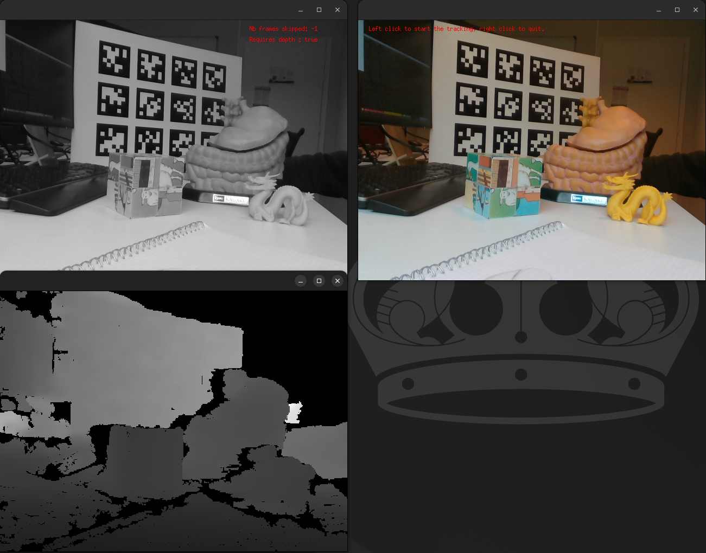
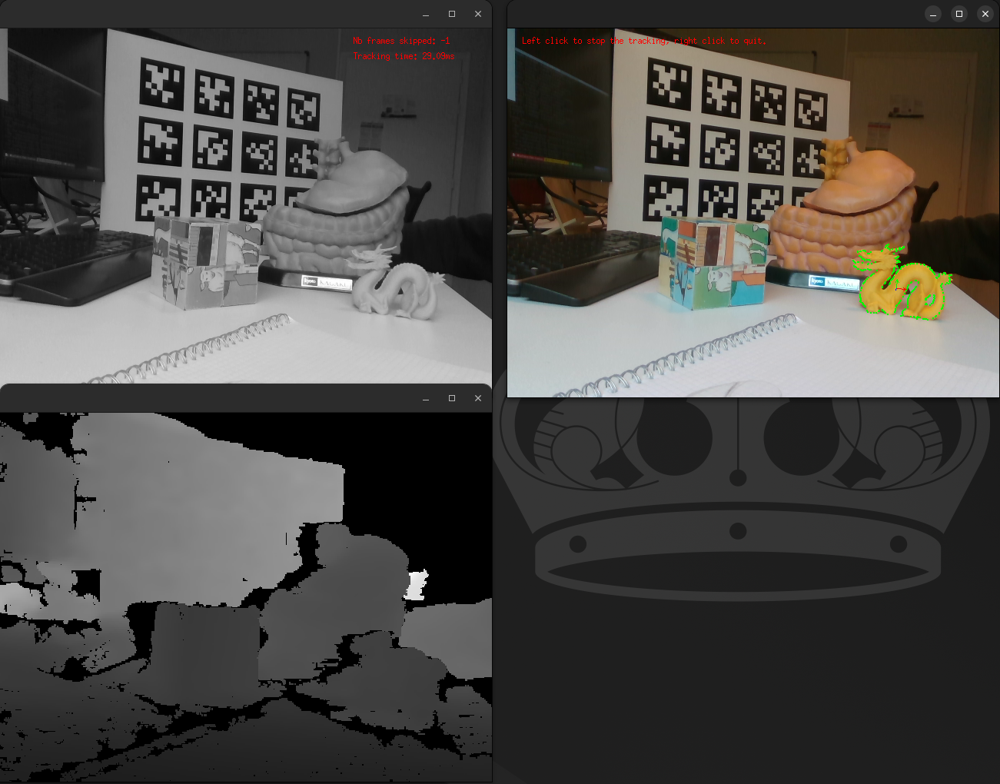

Render-Based Tracker (RBT) tutorial
===================================

This is a tutorial for the ``visp_rbt`` package. The documentation of the Render-Based Tracker (RBT) provided
by ViSP can be found `here <https://https://visp-doc.inria.fr/doxygen/visp-daily/classvpRBTracker.html>`__
ViSP documentation also provides step-by-step tutorials to progressively learn how to use the RBT
`here <https://visp-doc.inria.fr/doxygen/visp-daily/tutorial-tracking-rbt.html>`__ .

Consequently, this tutorial will not focus on explaining the meaning of the different parameters of the
RBT, but instead focus on the specificities on how to use the ``visp_rbt`` package.

Tutorial using a recorded sequence
----------------------------------

Purpose of this tutorial
++++++++++++++++++++++++

The purpose of this tutorial is to show how to configure a ``visp_rbt`` node on a recorded sequence.
We begin with this setup because it is less prone to runtime errors, such as problems with a camera.

How to launch it
++++++++++++++++
If you compiled the packages, you have to source the workspace in which you have compiled the packages.
Otherwise, if you installed the packages using the package manager, you only have to source the ``/opt/ros/${ROS_DISTRO}/setup.bash``
file (or one of the other ``setup`` files if you are not using bash).

Then you can run:

.. code-block:: shell

  ros2 launch visp_tk_tutorials rbt_bag_launch.py

The launch file accepts different arguments. To have the list and the explanations related to the
arguments, please run:

.. code-block:: shell

  ros2 launch visp_tk_tutorials rbt_bag_launch.py --show-args

You can for instance easily switch between the object to track thanks to the ``object_name`` launch argument.

.. list-table::
   :header-rows: 1
   :widths: 20 50 30

   * - ``object_name``
     - Tracked features
     - Configuration file
   * - ``dragon`` (default)
     - | Dense depth (``depth``) and color silhouette
       | (``silhouetteColor``, CCD), with an object mask
     - ``depth-ccd-mask.json``
   * - ``cube``
     - | Dense depth (``depth``) and color silhouette
       | (``silhouetteColor``, CCD), with an object mask
     - ``depth-ccd-mask.json``
   * - ``stomach``
     - | Dense depth (``depth``) and color silhouette
       | (``silhouetteColor``, CCD), with an object mask
     - ``depth-ccd-mask.json``

``object_name`` only selects the 3D model and the initial pose of the object: the three objects use the same
default configuration file, which can be changed with the ``config_file`` launch argument
(see `Using another configuration file`_ below).

When you first start the launch file, you should see something similar to the following image:

After left clicking on the image, the tracker will be turned on. Be careful, you have to do it in less than
5 seconds, because we chose to publish the initial pose of the object to track in order to avoid the initialization
from clicks. If you chose for instance to track the dragon, you should see something like the following image:

Afterwards, a left click will momentarily pause the tracker, while a right click will kill the node.

Using another configuration file
++++++++++++++++++++++++++++++++

The features used by the RBT and their settings are given by a JSON configuration file, passed with the
``config_file`` launch argument. It must be an absolute path. To use one of the configuration files installed
with the package, you can build this path with ``ros2 pkg prefix``:

.. code-block:: shell

  ros2 launch visp_tk_tutorials rbt_bag_launch.py \
    config_file:=$(ros2 pkg prefix visp_tk_tutorials)/share/visp_tk_tutorials/config/rbt/configs/depth-klt.json

The following configuration files are provided in ``config/rbt/configs``. The features are named after the
``type`` key of the file, which is also the name displayed by the tracker in the ``Features:`` lines.

.. The HTML theme does not wrap the text of table cells: the lines of the second column are thus
   broken explicitly with line blocks ("| "), so that the table fits the page width without scrolling.

.. list-table::
   :header-rows: 1
   :widths: 30 70

   * - File
     - Content
   * - ``depth-ccd-mask.json``
     - | Default. Depth (``depth``) and color silhouette
       | (``silhouetteColor``, CCD), with an object segmentation
       | mask that rejects the features lying on the background.
   * - ``depth-ccd.json``
     - | Same features as ``depth-ccd-mask.json``,
       | without mask.
   * - ``depth-klt-ccd-mask.json``
     - | ``depth-ccd-mask.json`` with KLT keypoints (``klt``)
       | tracked on the object texture.
   * - ``depth-klt.json``
     - | Depth and KLT keypoints only, no silhouette.
   * - ``depth-klt-me-single.json``
     - | Depth, KLT and moving edges along the silhouette
       | (``silhouetteMe``), keeping one edge candidate per point.
   * - ``depth-klt-me-multi.json``
     - | Same as ``depth-klt-me-single.json``,
       | keeping 3 edge candidates per silhouette point.
   * - ``ccd.json``
     - | Color silhouette (CCD) only:
       | does not require a depth stream.
   * - ``ccd-temporal-smoothing.json``
     - | Same as ``ccd.json``, with the color statistics
       | smoothed over time.
   * - ``orangina-depth-klt-ccd-mask.json``
     - | Tuned for the Orangina can,
       | see :ref:`rbt-live-other-config` below.
   * - ``castle-depth-klt-ccd-mask.json``
     - | ``depth-klt-ccd-mask.json`` tuned to reduce
       | the tracking time on the castle.

The parameters of these files, and the values that differ between them, are described in
``config/rbt/configs/README.md``.

If the file does not exist, the tracker cannot be initialized: the error ``config file ... does not exist``
is displayed, the node stops and the launch file ends.

Code explanation
++++++++++++++++

Let's have a look at ``rbt_bag_launch.py``. Because it is a fairly big file, we will study the parts
separately. Let's first have a look to the :py:func:`generate_launch_description` method that is called
by the ``ros2 launch`` utilitary or by a call to ``IncludeLaunchDescription`` in another launch file:

.. literalinclude:: /_code/launch/rbt_bag_launch.py
  :language: python
  :lineno-match:
  :start-at: def generate_launch_description():
  :end-at: return ld

As you can see, the :py:func:`generate_launch_description` method mostly declare the launch arguments and
register an :py:class:`OpaqueFunction` object that will be called once the context of the launch file will
be known. However, it is important to notice that it also sets an OpenMP environment variable. It helps accelerate
the processing of depth images when the depth stream is used too and helps accelerate the tracker.

Here is a quick overview of the :py:func:`handle_object_parameter` function:

.. literalinclude:: /_code/launch/rbt_bag_launch.py
  :language: python
  :lineno-match:
  :start-at: def handle_object_parameter(context):
  :end-before: def generate_launch_description():

First, we get the launch arguments values:

.. literalinclude:: /_code/launch/rbt_bag_launch.py
  :language: python
  :lineno-match:
  :start-at: ## [Getting the values of the tracker-related launch arguments]
  :end-before: ## [Handling tracked object]

Then, we chose the object model that will be used by the RBT node from the ``object_name`` launch arguments:

.. literalinclude:: /_code/launch/rbt_bag_launch.py
  :language: python
  :lineno-match:
  :start-at: ## [Handling tracked object]
  :end-before: ## [Sequence player]

Then, we create a node that will play the sequence, publishing the images, camera info and initial pose:

.. literalinclude:: /_code/launch/rbt_bag_launch.py
  :language: python
  :lineno-match:
  :start-at: ## [Sequence player]
  :end-before: ## [RBT tracker node]

Then, we instanciate the ``visp_rbt`` node, using the dictionnary that we previously filled:

.. literalinclude:: /_code/launch/rbt_bag_launch.py
  :language: python
  :lineno-match:
  :start-at: ## [RBT tracker node]
  :end-before: ## [Shutdown-event handler]

Finally, we ask to shutdown the whole launch file when the ``visp_rbt`` node dies:

.. literalinclude:: /_code/launch/rbt_bag_launch.py
  :language: python
  :lineno-match:
  :start-at: ## [Shutdown-event handler]
  :end-before: ## [Returning launch description items]

Tutorial using a Realsense camera
---------------------------------

Purpose of this tutorial
++++++++++++++++++++++++

The purpose of this tutorial is to show how to configure a ``visp_rbt`` node when using an RGBD sensor.
We chose to use a Realsense RGBD sensor because it makes available a topic on which the depth image is
aligned with the color image, which is a requirement for the RBT.

How to launch it
++++++++++++++++
If you compiled the packages, you have to source the workspace in which you have compiled the packages.
Otherwise, if you installed the packages using the package manager, you only have to source the ``/opt/ros/${ROS_DISTRO}/setup.bash``
file (or one of the other ``setup`` files if you are not using bash).

Then you can run:

.. code-block:: shell

  ros2 launch visp_tk_tutorials rbt_dragon_live_rs2_launch.py

The launch file accepts different arguments. To have the list and the explanations related to the
arguments, please run:

.. code-block:: shell

  ros2 launch visp_tk_tutorials rbt_dragon_live_rs2_launch.py --show-args

If nothing appears on screen, it may mean that the ``realsense_camera`` package changed the names of
the topic on which are published the data. Please run ``ros2 topic list`` and ``ros2 topic info -v /<camera_topic>``
to check if the ``realsense_camera`` publisher and the ``tracker_rbt`` subscriber are both listed.
If not, please change the topic names accordingly.

.. _rbt-live-other-config:

Using another object or configuration file
++++++++++++++++++++++++++++++++++++++++++

``rbt_orangina_live_rs2_launch.py`` tracks an Orangina can instead of the dragon. By default, it uses
``orangina-depth-klt-ccd-mask.json``, a configuration tuned for this object: since the can is symmetric around its
axis, the depth and silhouette features do not estimate the rotation around this axis, which is only given by the
KLT keypoints tracked on the label.

.. code-block:: shell

  ros2 launch visp_tk_tutorials rbt_orangina_live_rs2_launch.py

``rbt_teabox_live_rs2_launch.py`` tracks the teabox also used by the MBT tutorial, a box of
0.165 x 0.068 m and 0.08 m high. Its model ``config/rbt/models/teabox/teabox.obj`` is generated from the MBT model
``teabox.cao``, so that the same ``teabox.init`` file can be used. Since the box has no symmetry, it uses the default
configuration ``depth-ccd-mask.json``.

.. code-block:: shell

  ros2 launch visp_tk_tutorials rbt_teabox_live_rs2_launch.py

``rbt_stomach_live_rs2_launch.py`` tracks the anatomical model of the stomach and intestines, standing on its base,
which is also tracked in the recorded sequence of ``rbt_bag_launch.py`` (``object_name:=stomach``). It also uses the
default configuration ``depth-ccd-mask.json``.

.. code-block:: shell

  ros2 launch visp_tk_tutorials rbt_stomach_live_rs2_launch.py

``rbt_cube_live_rs2_launch.py`` tracks the textured cube, also tracked in the recorded sequence of
``rbt_bag_launch.py`` (``object_name:=cube``). Since its faces are covered with drawings, it uses
``depth-klt-ccd-mask.json``, which adds KLT keypoints tracked on these textures to the depth and silhouette features.
The number of silhouette points is limited to 512, which keeps the tracking time at about 20 ms.

.. code-block:: shell

  ros2 launch visp_tk_tutorials rbt_cube_live_rs2_launch.py

``rbt_castle_live_rs2_launch.py`` tracks a textured model of a castle (``config/rbt/models/castle/castle_rework.obj``).
It uses ``castle-depth-klt-ccd-mask.json``: the same features as for the cube, KLT keypoints being tracked on its
textured walls, but with fewer depth points and the color mask only computed around the object. With its long and very
jagged silhouette (battlements, towers), the tracking time is about 50 ms.

.. code-block:: shell

  ros2 launch visp_tk_tutorials rbt_castle_live_rs2_launch.py

As with ``rbt_bag_launch.py``, the JSON configuration file is given by the ``config_file`` launch argument.
It must be an absolute path, which can be built with
``ros2 pkg prefix`` for the files installed with the package, for example:

.. code-block:: shell

  ros2 launch visp_tk_tutorials rbt_orangina_live_rs2_launch.py \
    config_file:=$(ros2 pkg prefix visp_tk_tutorials)/share/visp_tk_tutorials/config/rbt/configs/orangina-depth-klt-ccd-mask.json

The other provided configuration files are listed in `Using another configuration file`_ above. The 3D model and the
file giving the points to click at initialization can be changed in the same way, with the ``model_file`` and
``init_file`` launch arguments.

Before starting the camera and the tracker, the live launch files check that the files given by
``config_file``, ``init_file`` and ``model_file`` exist. If one of them does not, the launch file ends
immediately with an explicit error, for example:

.. code-block:: shell

  [ERROR] [launch]: Caught exception in launch (see debug for traceback): Launch argument 'config_file': file '/path/to/file.json' does not exist

Code explanation
++++++++++++++++

We won't give a detailed explanation of the tracker parameters, because nothing of importance changed compared
to the previous launch file.

The main difference is that the RealSense driver (``realsense2_camera::RealSenseNodeFactory``) and the tracker
(``visp_rbt::RBTTracker``) are not started as two separate nodes, but loaded as components in the same
container, with intra-process communication enabled. The color and depth images (640x480, about 1 MB each)
are thus passed from the driver to the tracker without going through DDS, which would otherwise drop many of
these large messages and make the display jerky.

The container must be single-threaded (``component_container``, not ``component_container_mt``): the Panda3D
OpenGL context and the ViSP displays used by the tracker must always be used from the thread that created them.

The same approach is used by ``rbt_orangina_live_rs2_launch.py``, which tracks an Orangina can instead of the dragon.

Display of the object frame
---------------------------

When the tracking succeeds, the frame of the object is displayed on the image, with its X, Y and Z axes in red,
green and blue. Its size and thickness can be changed with two launch arguments, accepted by all the launch files of
this package:

.. list-table::
   :header-rows: 1
   :widths: 25 15 60

   * - Launch argument
     - Default
     - Meaning
   * - ``frame_size_ratio``
     - ``0.3``
     - | Length of the axes, as a fraction of the object diameter,
       | i.e. the diagonal of the bounding box of the 3D model.
       | The axes are never shorter than 30 pixels, so that they stay
       | readable when the object is far from the camera.
   * - ``frame_thickness``
     - ``2``
     - | Thickness of the axes, in pixels.

``rbt_stomach_live_rs2_launch.py`` and ``rbt_castle_live_rs2_launch.py`` set ``frame_size_ratio`` to ``0.15``:
the diagonal of the bounding box of these objects (about 35 cm for the stomach, 54 cm for the castle) overestimates
their apparent size.

For instance:

.. code-block:: shell

  ros2 launch visp_tk_tutorials rbt_bag_launch.py frame_size_ratio:=0.2 frame_thickness:=3
